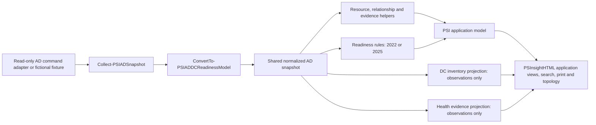

# Active Directory provider architecture

Milestone 11.12 places the reusable, read-only AD collection and normalization path under `Providers/ActiveDirectory`. It is private provider code, not a new public module API. The generic PSInsightHTML engine still receives ordinary PSI resources, relationships, evidence, checks, findings, and assessments.

## Layers and ownership

- `Collectors/` contains the existing domain-scoped read-only adapter, collector result/coverage handling, and live snapshot assembly. The adapter discovers domain, forest, DCs, sites, subnets, site links, replication partners, and optional remote, DNS, time, service, security, network, and dependency observations. It does not make readiness decisions.
- `Shared/` resolves collection profiles, accepts explicit dependency and backup input, coordinates one snapshot collection, and reports provider metadata. Profiles are collection scopes: `Core` is the default; `Operational` requests remote observations; `Health` adds CPU, installed features and bounded event queries to remote observations; `Security` requests remote and selected security observations; `Dependencies` requests dependency discovery; `Full` requests all supported optional collectors. Existing switches are additive and remain supported. In sample mode, the fixture supplies its established fictional values regardless of profile.
- `Normalization/` validates the raw snapshot and yields one typed contract for reuse. Required readiness fields remain present. Optional `Subnets`, `SiteLinks`, `Services`, `SecurityObservations`, `Relationships`, `CollectionEvents`, `CollectionProfile`, and `Metadata` are available for future assessment authors. `CollectionResults` retains `Collected`, `Partial`, `Failed`, `NotSupported`, `NotRequested`, and `NotTested` distinctions. Discovery does not imply reachability.
- `Models/`, `Relationships/`, and `Evidence/` convert normalized observations into generic PSI objects. The structural resource and relationship mappings are shared. The presentation mapper builds a forest/domain/site hierarchy and replication graph from the normalized snapshot. External replication partners are evidence-only nodes, never assessed resources. Collection evidence can be constructed independently of findings; rule evidence is created once per selected rule and target.
- `Rules/Readiness/` holds unchanged 2022/2025 rule data, source provenance, security review definitions, coverage requirements, and outcome logic. `Assessments/DCReadiness/` evaluates one selected target without mutating the snapshot. The same snapshot can be evaluated for both versions.
- `Fixtures/` owns fictional sample and mocked-live adapters. `Examples/ActiveDirectory/DCReadiness/Invoke-PSIADDCReadiness.ps1` composes the report and keeps the old CLI switches. Its other original function files remain small compatibility loaders so existing imports/tests/scripts work. The old `Examples/.../Rules/*.psd1` files remain temporarily for path compatibility; provider-owned copies are authoritative for new execution.

## Snapshot scope and provider input

The normalized snapshot has `Forest`, `Domains`, `DomainControllers`, `Sites`, `Subnets`, `SiteLinks`, `Replication`, `DNS`, `Time`, `Services`, `SecurityObservations`, `Dependencies`, `CollectionResults`, `CollectionEvents`, and `Metadata`. Some sections are empty when collection is not requested or supported. `Metadata.ResourceScope` is the selected domain. `Metadata.EvidenceScope` is the forest context. A forest or schema replication partner can be visible as evidence without expanding assessed DC inventory. The collector does not enumerate forest-wide DCs simply because the host is in a root domain.

Use `Collect-PSIADSnapshot -Domain ... -Profile Core` inside the provider. `-DependencyInput` accepts records with `Name`, `Type`, and optional `Version`, `Owner`, `Criticality`, `Notes`, and `EvidenceSource`. These are marked `ProviderInput` and `NotTested`; the provider does not infer their health. No live collector runs when `-UseSampleData` is supplied.

The normalized snapshot is reusable provider input. Readiness rules create their own PSI model and checks, leaving the snapshot unchanged. DC Inventory consumes it without rules. Future health, security, or compliance assessments can also consume the same snapshot, but those rules are outside this milestone. No generic guidance is labeled as a named control framework without an actual source mapping.

## DC Inventory consumer (Milestone 11.13)

`Models/New-PSIADDCInventoryModel.ps1` projects only domain-scoped inventory fields from the shared normalized snapshot. `Models/New-PSIADDCInventoryPresentation.ps1` creates neutral PSI resources, structural relationships, collection evidence, tree nodes, and replication topology nodes. No health statuses, findings, assessment, threshold rules, or score are attached. `Examples/ActiveDirectory/DCInventory/Invoke-PSIADDCInventory.ps1` composes the application and accepts `-Snapshot` to skip collection altogether. Its [example README](../Examples/ActiveDirectory/DCInventory/README.md) documents supported fields, profile semantics, gaps, usage and migration boundaries.

The already collected remote OS and NIC response projects memory, system drive and NIC address/subnet observations into the shared snapshot. The optional `Health` scope adds CPU and Windows feature observations. A single normalized snapshot can feed this inventory, both readiness target evaluations, and the Health evidence projection without mutation or recollection. See [Health evidence contract](ActiveDirectory-HealthEvidence.md).

## Complete overview consumer

`Invoke-PSIADCompleteOverview` is an exported pilot entry point. It collects one normalized DC snapshot and reuses it across the DC, readiness, health, security, compliance, DNS, replication, and site/subnet reports. Separate scoped read-only queries provide GPO, OU, group, user, and computer inventories. The linked `index.html` reports per-report failures rather than treating missing output as healthy. See [usage and limits](../Examples/ActiveDirectory/README-CompleteOverview.md).

## Safety and migration

Collectors are strictly read-only; the provider introduces no directory, DNS, policy, service-control, reboot, or registry mutation command. The command adapter and collection-result states remain the safety boundary. The existing GPO, Groups, Replication, DNS, Sites/Subnets, and User Inventory reports keep their current provider implementations. Their future migration opportunity is to reuse this snapshot's scoped inventory, collection coverage, and evidence records where their data needs overlap; their report-specific rules and presentation should remain separate. The current provider does not collect every future DC Inventory, AD Health, Security, or Compliance attribute.
